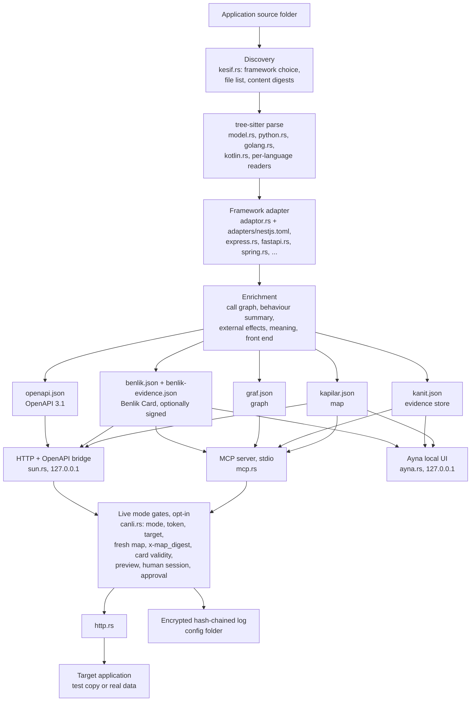

# Architecture

One page on how Sezgi turns source code into a map and how that map is served. Behaviour details are in [REFERENCE.md](REFERENCE.md); the threat model is in [SECURITY.md](../SECURITY.md).

Identifiers in the code (modules, functions, file names such as `kapilar.json`) are Turkish. [GLOSSARY.md](GLOSSARY.md) maps commands, flags and terms to English.

## Data flow

1. **Discovery** picks the framework and keeps each source file's SHA-256; `sezgi izle` re-parses only changed files.
2. **Parse:** each file is parsed once with tree-sitter, in parallel.
3. **Adapter:** framework conventions become endpoints, inputs, rules, auth and roles. NestJS conventions are data in `adapters/nestjs.toml`; other frameworks are Rust.
4. **Enrichment:** the call graph is walked from each endpoint to collect tables, access checks, rejections, cascades, outgoing calls and reversibility. Every fact gets a stamp (`certain`, `observed`, `inferred`, `unknown`).
5. **Outputs** are plain JSON in `<app>/.sezgi`. The card carries `x-map_digest`, the canonical SHA-256 of `kapilar.json`.
6. **Serving:** MCP, the HTTP bridge and Ayna re-sanitize the map on load.
7. **Live mode** (off by default) forwards a request only after every gate passes, and logs it.

## Modules

| Module | Responsibility |
|---|---|
| `main.rs` | Command line: dispatch of every command and its English alias |
| `kesif.rs` | Discovery: framework choice, parse cache, content digests of files the adapter read |
| `guvenli.rs` | Safe reading of untrusted repositories (no symlinks, 4 MiB file limit) and cleaning of code-derived text |
| `model.rs` | Framework-independent TypeScript model: imports, classes, decorators, fields |
| `python.rs` / `golang.rs` / `kotlin.rs` | Language models for Python, Go and Kotlin sources |
| `adaptor.rs` | NestJS adapter engine driven by `adapters/nestjs.toml`; shared endpoint structure |
| `express.rs`, `fastapi.rs`, `django.rs`, `flask.rs`, `spring.rs`, `ktor.rs`, `rails.rs`, `aspnet.rs`, `gohttp.rs`, `laravel.rs` | One adapter per framework, all producing the same endpoint structure |
| `kural.rs` | Validation rules in checkable form; checks a value against them without calling the app |
| `cagri.rs` | Function call graph and deep service analysis (tables, access checks, ownership) |
| `dna.rs` | Behaviour summary: conditional rejections, branches, soft deletes, events and jobs |
| `dis.rs`, `dis_zincir.rs` | External effects, reversibility and preconditions, followed over the call graph |
| `anlam.rs` | What the app is for: domain, quoted purpose, user types, capabilities |
| `web.rs`, `yolculuk.rs` | Front-end links (screen, UI action, client call) and user journeys |
| `kanit.rs`, `graf.rs` | Evidence store (`kanit.json`) and its node/edge view (`graf.json`) |
| `benlik.rs`, `imza.rs` | Benlik Card generation; ML-DSA-65 signing, key pinning, config folder location |
| `openapi.rs` | OpenAPI 3.1 document generated from the map |
| `mcp.rs`, `islem_arac.rs` | MCP server over stdio; per-operation tools for a token |
| `sun.rs`, `ayna.rs` | HTTP/OpenAPI bridge and local UI, both bound to 127.0.0.1 |
| `canli.rs`, `gercek_veri.rs`, `insan.rs` | Live mode gates, approvals, encrypted log; real-data rules; system anchor and human password |
| `http.rs`, `oidc.rs` | Minimal HTTP/TLS client (OS trust store); OIDC device flow and token exchange |
| `baglan.rs` | `sezgi bagla` / `sezgi kaldir`: connect AI tools with backups, undo |
| `rapor.rs`, `doktor.rs` | Coverage report (what is not known); read-only health check |
| `santral.rs`, `varlik.rs`, `plan.rs` | Several apps behind one server, entity mappings, change plans |
| `kesif/` | Inspection without source code (PE, APK, SQLite, Electron) and the optional REA bridge |

## Trust boundaries

**Untrusted input:**
- The repository being mapped: source files, manifests, README text, a committed `paylasim.bin`. Sezgi never runs it, does not follow symlinks and treats extracted text as data.
- Files shipped without source (`sezgi kesfet`).
- Responses from the target application in live mode. They are passed to the agent truncated to 8,000 characters, without masking.
- Anything an agent sends: arguments, role claims, approval-looking fields.

**Trusted anchors:**
- A Benlik Card signed with a key the user pinned (`sezgi key pin`). A key shipped next to the card proves integrity, not identity. With an unsigned card, `x-map_digest` is only a consistency check.
- The human password checked against the system anchor (`/etc/sezgi/insan-<uid>.json` or `C:\ProgramData\sezgi\insan-<user>.json`), which only an administrator can write. Real-data steps require it.
- Not trusted: anything else in the user's config folder, which a process under the same account can edit (see [SECURITY.md](../SECURITY.md)).

**Network:** building the map, `sezgi mcp` without a token, `sezgi ayna` and `sezgi sun` make no network requests, and Ayna and `sezgi sun` listen only on 127.0.0.1. Requests leave the machine only for live-mode calls to the configured target, the OIDC identity provider, the app's "current user" endpoint when chosen for roles, and `sezgi rea kur` (npm, after confirmation). The full list is in [SECURITY.md](../SECURITY.md#network).
